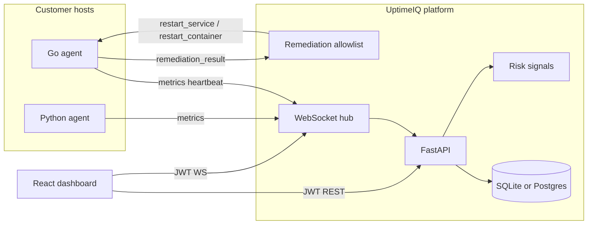

# UptimeIQ

**Live host observability with early-warning signals and allowlisted remediation.**

UptimeIQ is a full-stack infrastructure monitoring MVP: a lightweight agent streams metrics over WebSocket, the API stores history and evaluates alerts, and the dashboard shows live fleet health. It also includes **early failure-risk signals**.

> **Demo scope:** This is a portfolio / interview demo, not a production SaaS. Auth is a single demo user. Do not expose it to the public internet without hardening.

---

## Why this exists

Most monitoring demos stop at charts. This project pushes one step further:

1. **Ingest** — agents push live host telemetry
2. **Detect** — thresholds + behavioral alerts
3. **Anticipate** — trajectory-based early warnings from history
4. **Act safely** — propose → approve → execute → verify, with an allowlist only

---

## Quick start

**One liner (Windows):**

```powershell
.\start.ps1
```

**One liner (macOS / Linux):**

```bash
chmod +x start.sh && ./start.sh
```

**Or with Docker:**

```bash
docker compose up --build
```

Then open **http://localhost:5173** and sign in.

| Field | Value |
|-------|-------|
| Username | `admin` |
| Password | `admin123` |

Demo auth only (plaintext MVP). See [Demo scope](#demo-scope--limitations).

Prereqs for `start.ps1` / `start.sh`: Python 3.11+, Node 18+, Go 1.22+. Docker Compose needs Docker Desktop.

---

## Architecture



| Layer | Stack |
|-------|--------|
| Dashboard | React, Vite, Tailwind, Framer Motion |
| API | FastAPI, SQLAlchemy async, JWT |
| Data | SQLite locally; Postgres via Docker Compose |
| Agents | Go (preferred) + Python fallback |
| Live path | WebSocket `/ws/metrics` |

---

## What works today

| Area | Status |
|------|--------|
| Live metrics dashboard | Working |
| Alerts (threshold + behavioral) | Working |
| Setup walkthrough + agent zip download | Working |
| Early-warning risk signals | Working (indicative) |
| Allowlisted remediation audit trail | Working |
| Go agent + offline buffer + reconnect | Working |
| Multi-tenant SaaS / Tailscale | Roadmap |
| Validated downtime prediction | Roadmap — **not claimed** |

Details: [docs/SCOPE.md](docs/SCOPE.md)

---

## Feature notes (careful wording)

### Early-warning risk signals
The **Intelligence** tab estimates risk from recent minute-buckets: disk fill trajectory, memory growth, latency deterioration, recurring alerts.

These are **operator hints**, not certified outage predictions. The API always returns a disclaimer. Accurate downtime prediction needs labeled incident history and validation we have not claimed yet.

### Controlled remediation
Only two actions are allowlisted:

- `restart_service`
- `restart_container`

Workflow: detect/propose → approve → dispatch to agent → execute → verify → record.

The agent **rejects** anything outside the allowlist. No arbitrary shell from the AI or API.

---

## Repo layout

```
agent/          Python agent + one-command runner
agent-go/       Go agent (metrics, heartbeat, buffer, remediation)
backend/        FastAPI app
frontend/       React dashboard
docs/           Scope, demo recording script, verification
docker-compose.yml
```

---

## Verify locally

```powershell
cd backend
pip install -r requirements.txt
pip install -r requirements-dev.txt
python -m pytest -q
```

Or smoke the running API:

```powershell
python docs/verify.py
```

---

## Demo scope & limitations

- Single demo user; password compared in plaintext (MVP)
- Local SQLite by default; Postgres in Compose
- Remediation requires a connected Go agent and OS permissions for the target service/container
- Risk scores are heuristic; not validated against a labeled outage dataset
- Not hardened for public deployment (rate limits, RBAC, secrets management, etc.)

---

## Roadmap

1. Hashed passwords + multi-user tenancy  
2. Agent auth tokens per device  
3. Tailscale / private connectivity option  
4. Incident-labeled evaluation for risk models  
5. Expand allowlist only with explicit safety policy  

---

## License

MIT
